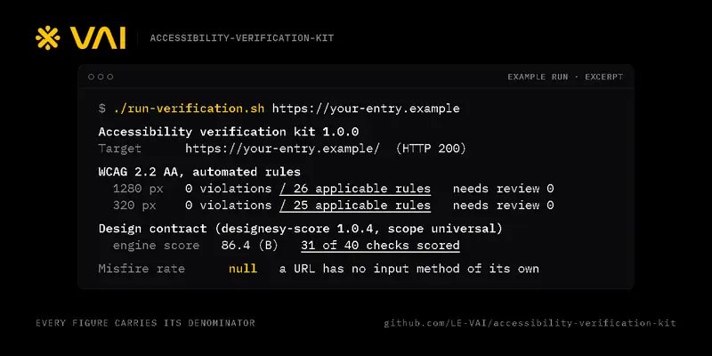

# Accessibility verification kit

<!-- vai-hero:start -->
<p align="center">
  <picture>
    <source media="(prefers-reduced-motion: reduce)" srcset="docs/media/hero-poster.png">
    
  </picture>
</p>
<p align="center"><sub>A 5-second loop. It plays once and rests, and shows a still frame if you prefer reduced motion. <a href="https://le-vai.github.io/LE-VAI/loops/#accessibility-verification-kit">Watch it on repeat</a>.</sub></p>
<!-- vai-hero:end -->

For the Opethon Accessibility & Inclusion track. Built by VAI, independent of
Opethon's organizers.

One command gives an entry an automated WCAG 2.2 AA result and a
design-contract score. Every figure carries its denominator and the command
that produced it, and a number the kit cannot stand behind prints as `null`
with the reason. Read [METHOD.md](METHOD.md) before trusting any number it
prints; it also lists what automated checks cannot see.

---

## For an entrant: run it on your entry

You need Node 22 or newer and Chrome, Edge, Chromium or Brave. There is
nothing to install.

```sh
./run-verification.sh https://your-entry.example
```

On Windows:

```powershell
.\run-verification.ps1 https://your-entry.example
```

Both wrappers run `node verify.mjs` with the same arguments, so that works
too.

Each run prints a summary and writes a folder under `verification-report/`:

| File | What it holds |
|---|---|
| `report.json` | every rule that ran, every violation with sample elements, every measurement, and the reason for any `null` |
| `summary.txt` | the summary the run printed |
| `contract-engine-output.txt` | the design-contract engine's raw output |

| Option | Effect |
|---|---|
| `--out <dir>` | where the report folder goes |
| `--browser <path>` | a specific browser (or set `CHROME_PATH`) |
| `--budget <s>` | seconds to wait for the page to settle (default 6) |
| `--settle <s>` | extra seconds before the rules run (default 3) |
| `--no-contract` | skip the design-contract engine |
| `--attach <port>` | scan inside a browser session you opened (below) |
| `--json` | print the full report instead of the summary |

Exit codes: `0` no automated violations, `1` violations found, `2` a WCAG
number was withheld and the report says why, `3` the run could not start.

### A local build

```sh
./run-verification.sh ./dist/index.html
```

The kit serves that folder on 127.0.0.1 for the length of the run. The
design-contract engine takes domain names only, so its slot prints `null` for
a local build.

### A page behind a browser check

Some hosts answer a fresh automated browser with a check page instead of the
page itself. The kit reads that response as text, never runs it, prints `null`
and stops. To scan the page a person is served:

1. Start a separate browser profile with a DevTools port.

   ```powershell
   & "$env:ProgramFiles\Google\Chrome\Application\chrome.exe" --remote-debugging-port=9222 --user-data-dir="$env:TEMP\kit-profile"
   ```

   ```sh
   # macOS
   "/Applications/Google Chrome.app/Contents/MacOS/Google Chrome" --remote-debugging-port=9222 --user-data-dir=/tmp/kit-profile
   # Linux
   google-chrome --remote-debugging-port=9222 --user-data-dir=/tmp/kit-profile
   ```

2. Open your page in that window, the way a visitor would.
3. Run the kit attached to it:

   ```sh
   ./run-verification.sh https://your-entry.example --attach 9222
   ```

4. Close that browser when you finish. While its DevTools port is open, any
   program on your machine can control it, which is why it gets its own
   profile with nothing signed in.

The report records that an attached session was used, because a session's
cookies can change what a page serves.

### An entry that ships an input method

Dwell clicking, switch scanning, gaze and EMG entries have one more figure: the
misfire rate, activations the person did not intend per hour the input was
armed. It is measured with
[access-conformance](https://www.npmjs.com/package/access-conformance), which
prints a rate only after 15 minutes of observed exposure and otherwise prints
`null` with the reason. `npx access-conformance` runs its reference session;
its README shows how to script a session of your own and names the
measurement protocol a real device session should follow.

---

## For a sponsor or a judge: check it

**Two minutes.** Open `index.html`. The worked example, the five rules every
number follows, and the list of what the kit cannot see are all on the page.

**Ten minutes.**

1. Check the engine file is the one npm publishes:

   ```sh
   sha256sum engine/axe.min.js
   curl -s https://cdn.jsdelivr.net/npm/axe-core@4.13.0/axe.min.js | sha256sum
   ```

   ```powershell
   Get-FileHash engine\axe.min.js -Algorithm SHA256
   ```

   All three should read `c24f097bd2f451d4f933e8bc7d8d539f8672a2ebcb5cc9f9f3eec8ca9470a0c1`.

2. Check the page against its receipts:

   ```sh
   node check-page.mjs
   ```

   It confirms every figure on the page matches its entry in `RECEIPTS.json`,
   and every entry matches the raw output it cites under `receipts/`.

3. Re-run a figure yourself. `node verify.mjs https://opethon.com/` from a
   fresh browser reproduces run A, the refusal. The figures from run B need
   the attached-session steps above.

## Run it yourself instead of trusting us

The rules engine is Deque's axe-core 4.13.0, unmodified. Any tool that runs
axe-core 4.13.0 with the tags `wcag2a`, `wcag2aa`, `wcag21a`, `wcag21aa` and
`wcag22aa` on the same page, at the same width, should produce the same
counts. Deque's own browser extension and command-line tool bundle their own
engine versions, so compare like with like.

The quickest independent check needs nothing from this folder but one file:
open the page in your browser, paste [console-check.js](console-check.js) into
the developer console and press Enter. It loads axe-core 4.13.0 from jsDelivr
with an integrity hash, so the browser refuses any other file, and prints
violations over applicable rules for the width you are viewing.

---

## What is in the folder

| Path | Purpose |
|---|---|
| `METHOD.md` | the method, its parameters, and what it cannot see |
| `verify.mjs` | the runner; no dependencies beyond Node and a browser |
| `run-verification.sh`, `run-verification.ps1` | one-command wrappers around the runner |
| `engine/axe.min.js` | axe-core 4.13.0, pinned by SHA-256 |
| `engine/LICENSE-MPL-2.0.txt` | the engine's license |
| `console-check.js` | the by-hand check for any page |
| `index.html` | the page for the track, readable offline |
| `RECEIPTS.json`, `receipts/` | every figure on the page, and the raw runs behind it |
| `check-page.mjs` | confirms the page, the receipts and the raw runs agree |

axe-core is copyright Deque Systems and is distributed under the Mozilla Public
License 2.0; its source is at https://github.com/dequelabs/axe-core.
